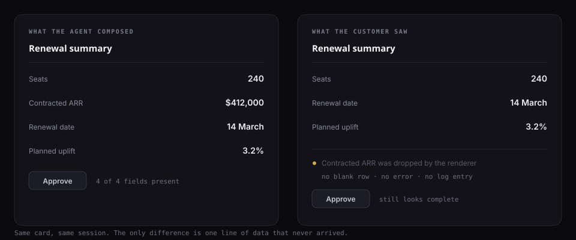

# What your agent showed the customer
Tag: project
Subtitle: Generated interfaces fail by omission, and nothing in the stack notices.
---
The failure I keep describing to people is a renewal summary: four facts on one card, seats, contract value, renewal date, planned uplift. It is a composite of screens I have seen rather than one incident, and that is part of the problem. Every team building these will recognise the shape.

The assistant composes the card with all four numbers. The customer's screen shows three. The missing one is the contract value. There is no blank row and no placeholder, because the renderer was told to skip a piece it could not resolve. The card closes up around the gap and looks finished. The customer reads the remaining numbers, assumes the fourth is unchanged, and takes that assumption to their CFO. Nobody files a bug, because from the outside nothing failed.

## The failure mode is new, the silence is not

Classic software fails loudly at the boundary between data and screen. A required field that never arrives throws, a null prints as a broken label, an empty result set gives the table a sentence to say. The screen is bound tightly enough to the data that a gap becomes visible to somebody.

A generated interface is assembled at display time from parts the model chose. The runtime validates the envelope, then hands the renderer a list of pieces: a heading, a card, this field bound to that value. If a piece is missing, or points at data that is not in the payload, the renderer is expected to skip it and keep going.

Skipping is the right behaviour. It is what lets a surface paint progressively while the model is still streaming, and it is why a slow tool call does not blank the screen. The same rule that makes progressive rendering work makes disappearance invisible.

## What you already monitor will not catch it

Your tests exercise the API and pass, because the API returned a valid response.

Your logs record the request the user made and the reply the model gave.

Your dashboards count errors, and nothing errored.

Your QA clicks the happy path, and the happy path renders four numbers because the fixture has four.

Every one of those checks watches the data or the process. None of them watches the surface the customer actually looked at. The gap lives in the last inch, between the description of the screen and the pixels, and nothing in a normal stack is positioned there.

That is why the only report you get is "it looked fine", and why support cannot reproduce it a week later.

## The question that ends the argument

Sooner or later somebody asks whether the assistant told a customer something it should not have, or failed to tell them something it should. The useful version of that question is narrow and answerable: what exactly did the assistant put on this customer's screen on Tuesday?

If the honest answer requires replaying a model session from memory, or asking the customer to describe what they saw, then you do not have a record of the thing that matters. You have a record of the request and the answer, which is not the same artefact.

I do not think this is a compliance exercise yet. It becomes one the first time a number that never rendered shows up in a contract negotiation.

## What a control looks like

The surface has a describable shape. An agent says: here is a heading, here is a card, this field is bound to this value, this button does this. That description is data, and data can be checked.

I built [groundglass](https://github.com/shobyde/groundglass) to check it. Point it at a captured stream and it rebuilds the screen the way a renderer would, then reports what a renderer would have swallowed: a child that points at a component nobody defined, a value bound to a path that is not in the payload, an input with no label, a button with nothing in it, a piece that nothing on screen ever references.

The half I care about more is the fault injection. It takes a stream you believe is good, breaks it twelve ways, and fails if the break is not detected. A truncated message. A surface with no root. A container that includes itself. A producer still speaking last year's wire format. Each one declares the finding it should produce, so the harness tests itself instead of trusting its own claims.

That is not a demo of agentic UI. It is the part of agentic UI that decides whether you can ship it.

## What this does not do

It checks structure, not truth. If the model writes the wrong number into a well-formed field, every check passes and the customer reads the wrong number. That is a different problem with different tools, and pretending a conformance check covers it would be the exact overclaim this work exists to prevent.

It checks one protocol. The shape differs across the ecosystem, and the reasoning does not.

It says nothing about latency, which is the other half of whether a generated surface is usable.

And it still needs a person to look at the screen. The point is to make that look cheap and repeatable, not to replace it.

## One question for Monday

Ask your team what the assistant put in front of your last ten customers, and whether anyone can show you without opening a model trace.

If the answer is a shrug, the surface is currently unaudited. That is worth knowing before a customer tells you what they saw.
