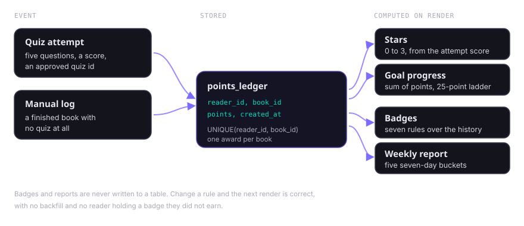

# Readback 0.2.0: rewards, and a catalog that fills the shelf
Tag: project
Subtitle: Readback 0.2.0 adds the Accelerated Reader catalog, stars, goals, badges, stickers, and a log that accepts books with no quiz.
---
I keep two versions of the same idea. One is a small Accelerated Reader clone running on a home server for my kids, with a parent review gate and points. The other is Readback, the public version I published in October. The private one was more fun. The public one was more careful.

This release moves the fun into the public one without dropping the care. It is tagged 0.2.0, and the [release notes](https://github.com/shobyde/readback/releases/tag/v0.2.0) cover the whole change.

## The catalog, and why an empty list is a lie

My home app scraped AR BookFind for real quiz numbers and point values. That scraper broke when BookFind moved from ASP.NET WebForms to Razor Pages, and I fixed it by reading the new markup. Porting it into Readback forced a different failure policy.

The home version returned an empty list when parsing failed, which looks identical to "this book has no AR quiz". A parent would retype the title, get nothing, and conclude the book is missing. The ported client raises ArBookFindError and says it could not read the page. That is a worse minute and a better hour.

What gets stored is metadata: quiz number, ATOS level, interest level, AR points, catalog summary. No AR quiz content is copied. Readback still asks a model for its own questions and still requires a parent to edit and approve them. BookFind supplies the reference fields; the questions still come from a model and a parent.

If the site changes again, the lookup fails loudly. I would rather ship a tool that admits it is broken than one that quietly returns nothing.

## Rewards that cannot lie

The family app had stars, goals, badges, and stickers. I ported all of it, with one structural change: badges are queries, not rows.

A stored badge is a fact about the past. Change the rule, and every stored badge becomes a small lie until a migration re-evaluates everyone. Deriving the list on each render keeps it consistent with the ledger, and correcting a rule fixes history automatically. The cost is a few extra queries per page load, which at family scale does not matter.

The rest of the layer follows that shape. Stars are computed from the attempt score at read time. Goal progress sums the ledger against a 25-point ladder. The weekly report buckets ledger rows by date. One source of truth, several projections.

Stickers are the exception, because decoration can be a preference. A parent can pin an emoji to a book. Books without one get a deterministic fallback from the book id, so the shelf never has an empty square.

## The migration I put off for a day

Books with no quiz were the awkward part. My kids read picture books and read-alouds with no AR test, and the family app logged those with a fake attempt row and a quiz id of zero. Readback had `quiz_id INTEGER NOT NULL`, which stopped matching reality.

SQLite cannot relax a NOT NULL constraint in place. The migration builds a new attempts table, copies every row with the book id taken from its quiz, drops the old table, and renames the new one. Foreign keys have to be off for that copy. With them on, dropping `attempts` cascades through `points_ledger` and `attempt_answers` and deletes the family's history.

That statement deserves a test rather than a comment. `tests/test_migration.py` builds a real 0.1.0 schema with a reader, a book, an approved quiz, one answer, and one ledger row, then runs the upgrade and checks three things: every row survived, the old attempt got its book id, and `PRAGMA foreign_key_check` returns nothing. A migration's risk lives in the rows you forgot were related.

## What I am still unsure about

Badges are a motivation device. They do not measure reading. A kid can log a book they skimmed and the app will award points once. The parent remains the check, the same as the approval gate on quizzes. I am comfortable with that for a family tool, and I would not sell the same points to a school as assessment.

The catalog client depends on someone else's markup. Every scraper does. There is no public AR catalog API a family can use, so the choice is scraping or typing quiz numbers by hand. I chose scraping and wrote the failure path first.

Weekly points are a weak measure of reading volume. One 15-point book and three 5-point books look the same in the chart. Pages or minutes would be better, but neither is in the data, and asking a seven-year-old to time herself is worse than an imperfect chart.

The release is 260 tests, up from 185, and upgrades an existing database in place. My kids will not notice the architecture. They will notice the stars.
